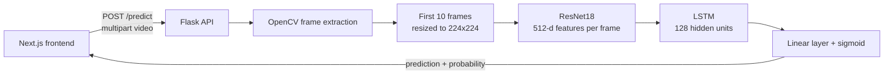

# Apollo: Deepfake Video Detection

Apollo is a full-stack web application that classifies uploaded videos as real or AI-generated. It pairs a PyTorch CNN-LSTM model with a Flask inference API and a Next.js frontend.

## Features

- Upload a video in the browser and get a `REAL` or `FAKE` prediction with a deepfake probability
- CNN-LSTM model: ResNet18 extracts features from each frame, and an LSTM processes the frame sequence
- REST API for running predictions without the frontend
- Trained checkpoint included, so the app runs without retraining
- Training and S3 data-loading code included for reference and reproducibility

## Architecture



### Model

| Stage | Details | Output shape |
| --- | --- | --- |
| Input | Sequence of 10 RGB frames, 224x224 | `(batch, 10, 3, 224, 224)` |
| CNN | ImageNet-pretrained ResNet18 with its classifier removed, applied to each frame | `(batch, 10, 512)` |
| LSTM | 1 layer, 128 hidden units; only the final time step is used | `(batch, 128)` |
| Classifier | Fully connected layer producing one logit | `(batch,)` |

A sigmoid converts the logit to a probability. Videos scoring 0.5 or higher are labeled `FAKE`.

### Request flow

1. The user selects a video in the frontend, which posts it to the Flask API.
2. The backend saves the upload temporarily and extracts its frames with OpenCV.
3. The first 10 frames are resized to 224x224 and converted to tensors.
4. The model runs on that sequence and produces a deepfake probability.
5. The API deletes the temporary files and returns the result, which the frontend displays.

## Tech Stack

| Area | Technologies |
| --- | --- |
| Machine learning | PyTorch, torchvision (ResNet18), scikit-learn (evaluation report) |
| Video processing | OpenCV, Pillow |
| Backend | Python, Flask, Flask-CORS |
| Frontend | Next.js 15, React 19, Tailwind CSS 4, Axios |
| Data storage | AWS S3 (boto3, python-dotenv) |

## Project Structure

```text
Apollo/
├── backend/
│   ├── app.py                   # Flask app and /predict endpoint
│   ├── deepfake_model.py        # CNN-LSTM model and predict_deepfake()
│   ├── train.py                 # Dataset class and training loop
│   ├── s3_download.py           # Optional: download videos from S3 and extract frames
│   └── deepfake_cnn_lstm.pth    # Trained model weights
├── frontend/
│   ├── app/
│   │   ├── page.js              # Upload interface and results
│   │   ├── layout.js            # Root layout
│   │   └── globals.css          # Global styles
│   ├── public/                  # Static assets, including the Apollo logo
│   └── package.json
├── main.py                      # Early development script, kept for reference
├── sample_vid.mp4               # Short sample video for testing
├── requirements.txt
└── README.md
```

The dataset (`downloaded_videos/`, `extracted_frames/`) and `.env` are excluded by `.gitignore`.

## Getting Started

### Prerequisites

- Python 3.12 (the version used in development)
- Node.js 18.18 or later, with npm

### 1. Clone the repository

```bash
git clone https://github.com/HamzaPrograms/Apollo.git
cd Apollo
```

### 2. Set up the Flask backend

Create and activate a virtual environment:

```bash
python -m venv .venv

# Windows (PowerShell)
.venv\Scripts\Activate.ps1

# macOS / Linux
source .venv/bin/activate
```

Install the dependencies:

```bash
pip install -r requirements.txt
```

Start the API from inside `backend/`, because the checkpoint is loaded by relative path:

```bash
cd backend
python app.py
```

The API runs at `http://localhost:5000`. On first startup, torchvision downloads the ResNet18 weights if they aren't already cached, so an internet connection is required.

### 3. Set up the Next.js frontend

In a second terminal, from the repository root:

```bash
cd frontend
npm install
npm run dev
```

The app runs at `http://localhost:3000`.

## Usage

### Web interface

1. Make sure the backend and frontend are both running.
2. Open `http://localhost:3000`.
3. Click **Choose File** and select a video. You can use `sample_vid.mp4` from the repository root.
4. Click **Analyze Video** to see the prediction and probability.

### API

**`POST /predict`** accepts `multipart/form-data` with the video in a field named `video`.

```bash
curl -X POST -F "video=@sample_vid.mp4" http://localhost:5000/predict
```

```json
{
  "prediction": "REAL",
  "probability": 0.0997
}
```

`probability` is always the likelihood that the video is **fake**, not the confidence in the returned label. A value of `0.0997` means a roughly 10% deepfake probability, so the video is labeled `REAL`.

| Status | Meaning | Response body |
| --- | --- | --- |
| `200` | Prediction succeeded | `prediction` and `probability` |
| `400` | No `video` field in the request | `{"error": "No video uploaded"}` |
| `500` | Processing failed, for example because the video has fewer than 10 frames | `{"error": "<message>"}` |

## Training the Model

Training is only needed to replace the included checkpoint. The dataset is not included in this repository.

### 1. Prepare the data

`train.py` reads JPEG frames from `extracted_frames/`, relative to the repository root, using the folder name as the label:

```text
extracted_frames/
├── real/    # label 0
│   └── <video_name>_frame_<n>.jpg
└── fake/    # label 1
    └── <video_name>_frame_<n>.jpg
```

To download videos from S3 and extract frames, create a `.env` file in the repository root:

```env
AWS_ACCESS_KEY=your_access_key
AWS_SECRET_KEY=your_secret_key
AWS_REGION=your_region
```

Set `BUCKET_NAME` in `backend/s3_download.py` to your own bucket, with the videos stored under `raw/`, then run this from the repository root:

```bash
python backend/s3_download.py
```

This script writes all frames directly into `extracted_frames/`, so you must sort them into `real/` and `fake/` before training.

### 2. Train

Run training as a module from the repository root:

```bash
python -m backend.train
```

The checkpoint is saved to the repository root. Move it to `backend/` for the API to use it:

```bash
mv deepfake_cnn_lstm.pth backend/deepfake_cnn_lstm.pth
```

| Setting | Value |
| --- | --- |
| Sequence length | 10 consecutive frames from a randomly chosen start position |
| Train / test split | 80% / 20% (`random_split`) |
| Batch size | 4 |
| Epochs | 10 |
| Loss | `BCEWithLogitsLoss` |
| Optimizer | Adam, learning rate `1e-4` |

Training uses CUDA when available and otherwise falls back to the CPU.

### Evaluation

`train.py` creates the test split but doesn't evaluate on it. The evaluation code (test accuracy and a scikit-learn `classification_report`) is in `main.py`, currently commented out.

## Limitations

- **Short analysis window:** predictions use only the first 10 frames of a video, so later manipulation isn't examined.
- **Local development setup:** the API runs on Flask's debug server, and the frontend's API URL is hardcoded to `http://localhost:5000` in `frontend/app/page.js`.
- **One request at a time:** uploads and frames use fixed temporary paths, so concurrent requests can conflict.

## Disclaimer

Predictions reflect patterns the model learned from its training data. They should not be treated as definitive proof that a video is real or fake.
